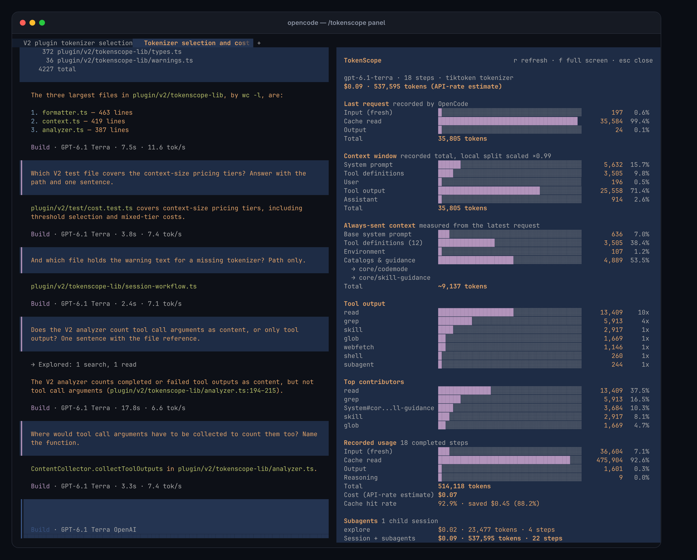
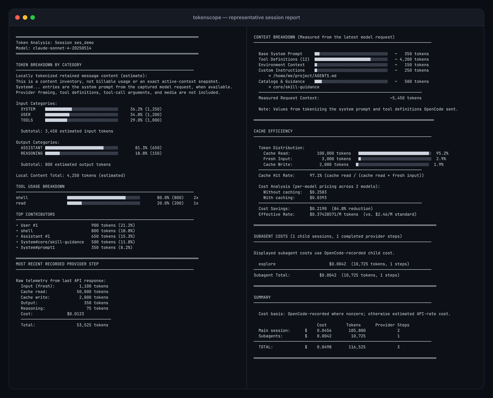

# OpenCode TokenScope

[](https://www.npmjs.com/package/@ramtinj95/opencode-tokenscope)

> Token usage, cache, context, and cost analysis for OpenCode sessions.

TokenScope turns the telemetry OpenCode has persisted for a session into a readable report. It keeps recorded usage separate from local tokenization and explanatory estimates, so the output does not imply precision the source data cannot support.

## Installation

The same package supports OpenCode V2 and OpenCode V1. Use the section for the version reported by `opencode --version`.

### OpenCode V2

```bash
opencode plugin add @ramtinj95/opencode-tokenscope
```

Or add the package to `plugins` in `opencode.json(c)` (in your project or at `~/.config/opencode/opencode.jsonc` for global use):

```jsonc
{
  "$schema": "https://opencode.ai/config.json",
  "plugins": ["@ramtinj95/opencode-tokenscope"]
}
```

Restart OpenCode and run `/tokenscope` in a session to open the [token usage panel](#token-usage-panel-opencode-v2). On V2 the plugin registers its commands itself, so there is no command file to create.

### OpenCode V1: npm (Recommended)

1. **Install globally:**

   ```bash
   npm install -g @ramtinj95/opencode-tokenscope
   ```

2. **Add the plugin to `opencode.json`** (in your project root or at `~/.config/opencode/opencode.json` for global use):

   ```json
   {
     "$schema": "https://opencode.ai/config.json",
     "plugin": ["@ramtinj95/opencode-tokenscope"]
   }
   ```

3. **Create the `/tokenscope` command** at `~/.config/opencode/command/tokenscope.md`:

   ```bash
   mkdir -p ~/.config/opencode/command
   cat > ~/.config/opencode/command/tokenscope.md << 'EOF'
   ---
   description: Analyze token usage across the current session with detailed breakdowns by category
   ---

   Call the tokenscope tool directly without delegating to other agents.
   Leave sessionID unset unless the user explicitly asked to analyze a different session.
   Then read the exact unique report path returned by TokenScope.
   Return that file verbatim without additional text or formatting.
   EOF
   ```

4. **Restart OpenCode** and run `/tokenscope`.

To ask OpenCode's package resolver for the latest npm release, use `@latest`:

```json
{
  "plugin": ["@ramtinj95/opencode-tokenscope@latest"]
}
```

### Install Script (V1 and V2)

```bash
curl -sSL https://raw.githubusercontent.com/ramtinJ95/opencode-tokenscope/main/plugin/install.sh | bash
```

The script checks `opencode --version`. On OpenCode V2 it runs `opencode plugin add` and lists leftover files from a V1 script install. On OpenCode V1 it installs the plugin and command into `~/.config/opencode`, which requires Bash, curl, npm, and an existing OpenCode config directory. Restart OpenCode, then run `/tokenscope`.

## See TokenScope in Action

### Token usage panel (OpenCode V2)



On OpenCode V2, `/tokenscope` opens a panel beside the session instead of printing a report into it. The command is also in the command palette as "Token usage report".

- **No model request.** The panel reads the analysis directly from the plugin, so opening it costs nothing and adds nothing to the session being measured.
- **Stays current.** It reloads on its own each time the session finishes a turn.
- **Provider numbers as totals.** The last request, recorded usage, and session totals are the counts OpenCode recorded from the provider. The provider reports one count per request, not what it was made of, so the split by source (system prompt, tool definitions, user, tool output, assistant) is tokenized locally and then scaled so it adds up to the recorded context of the last request. The panel shows the scale it applied, for example `×0.99`.
- **Sections.** The session total, warnings, the last request, the context window by source, the always-sent context (system prompt and tool definitions), tool output by tool, top contributors, recorded usage with cost and cache hit rate, and subagents when the session has any.
- **Cost basis.** Costs are the ones OpenCode recorded. Where it recorded $0, for the session or for a subagent, the panel shows an API-rate estimate marked `(estimate)`, and a total that adds recorded and estimated amounts is marked `(partly estimated)`.

| Key | Action |
| --- | --- |
| `r` | Reload the report |
| `f` | Toggle between the side panel and full screen |
| `↑` `↓` `PgUp` `PgDn` | Scroll |
| `esc` | Close the panel |

The split is left as an unscaled local estimate, and labeled as one, when the request was not captured (a session with no request since OpenCode started) or when the local estimate is more than twice or less than half the recorded context. The text report prints local estimates unscaled.

On a narrow terminal OpenCode shows the panel full screen. For the complete text report, run `/tokenscope-report`.

### Text report



<sub>Representative OpenCode V2 report generated by TokenScope from the repository's deterministic sample session. On OpenCode V1 the layout is the same and the context breakdown is estimated instead of measured.</sub>

A report brings the session's main signals together:

- **Recorded provider-step telemetry:** fresh input, cache reads/writes, output, reasoning, completed steps, and OpenCode-recorded cost
- **Retained content inventory:** estimated tokens by system override, user, assistant, reasoning, and replayable tool output
- **Cache analysis:** hit rate, effective input rate, and estimated savings at public API prices
- **Recursive subagent totals:** child-session usage, cost, and provider steps, with an optional detailed bucket breakdown
- **Context explanations:** bounded estimates for tool definitions, environment context, custom instructions, skills, and available subagents
- **Visible uncertainty:** warnings identify missing pricing, tokenizer fallbacks, unavailable metadata, export failures, or incomplete child-session data

## Compatibility

| OpenCode | Plugin API | Implementation |
| --- | --- | --- |
| V2 (2.0 and newer) | `@opencode/plugin` | `plugin/v2/`, verified against OpenCode v2.2.6 |
| V1 | `@opencode-ai/plugin >=1.1.48` | `plugin/tokenscope.ts`, unchanged from TokenScope 1.8.1 |

One package serves both, and each OpenCode major loads only its own implementation: `main` in `package.json` points at the V1 module, which is what OpenCode V1 reads, and `exports` points at the V2 module, which is what OpenCode V2 resolves. V1 support is kept for a transition period and receives fixes only.

On V1, the accuracy contracts were verified against OpenCode v1.17.18; older runtimes can differ in explanatory skill or tool formatting even when core telemetry remains available.

TokenScope is an OpenCode plugin and tool, not a standalone CLI or transcript-file analyzer. The runtime report path is cross-platform; the one-line install script is intended for Unix-like environments with Bash.

### Moving from OpenCode V1 to V2

1. In `opencode.json`, rename `plugin` to `plugins`.
2. Remove `~/.config/opencode/command/tokenscope.md`; on V2 the plugin registers `/tokenscope` and `/tokenscope-report` itself.
3. If you used the install script on V1, remove the files it copied into `~/.config/opencode/plugin/` (`tokenscope.ts`, `tokenscope-lib/`, `dist/`, `models.json`, `install.sh`). OpenCode V2 still scans that directory and logs a load failure for them. Running the install script again on V2 lists them.
4. `~/.config/opencode/tokenscope-config.json` keeps working.

## Usage

| Command | OpenCode V2 | OpenCode V1 |
| --- | --- | --- |
| `/tokenscope` | Opens the [token usage panel](#token-usage-panel-opencode-v2); no model request | Has the model print the text report |
| `/tokenscope-report` | Has the model print the text report | Not available |

The text-report command is a small prompt (a prompt file on V1, registered by the plugin on V2) that invokes the plugin's `tokenscope` tool, reads the exact report path it returns, and prints the report verbatim. Agents can also call the tool directly. The panel always analyzes the session it is opened in, with the default tool options.

### Tool Options

| Option | Default | Behavior |
| --- | --- | --- |
| `sessionID` | current session | Analyze a specific session. Blank values use the current session. |
| `limitMessages` | `3` | Entries shown per category; integer from 1 to 10. |
| `includeSubagents` | `true` | Recursively include child-session usage and cost. |

Each invocation writes a unique report to a private directory under the operating system's temporary directory and returns its exact path. Reports are not written into the analyzed worktree, and concurrent invocations cannot overwrite one another. The OS owns eventual cleanup.

When the private report location is available, missing, empty, or inaccessible sessions produce a short report explaining the failure instead of polluting the project or silently returning partial output. If the location cannot be created or written, the tool returns an explicit inline error.

## How to Read the Report

TokenScope deliberately separates three kinds of numbers:

1. **Recorded usage snapshot** — persisted OpenCode `step-finish` telemetry, with an assistant-message aggregate fallback for older data. This is the strongest available source for fresh input, cache read/write, visible output, reasoning, recovered calls/steps, and OpenCode-recorded cost.
2. **Local content inventory** — tokenizer estimates over retained text and replayable tool output. These help identify contributors but are not billable usage or an exact reconstruction of the next provider request.
3. **Explanatory estimates** — public API-rate cost, cache savings, cached-context attribution, tool schemas, and skill/subagent catalogs. These are labeled as estimates and kept out of recorded totals.

See the [report reference](docs/report-reference.md) for a section-by-section explanation of the calculations, exclusions, and reconstruction limits.

### Snapshot Boundary

The provider step that invokes TokenScope is not included because OpenCode persists its `step-finish` only after the tool returns. The later report-reading and final-response steps are also outside that snapshot.

Compaction and active reverts can make the retained transcript differ from the next provider request. Deleted or reverted-away history cannot be reconstructed as lifetime spend from the session API.

### Cost Boundary

OpenCode normally calculates recorded cost from normalized usage and model metadata; it is not necessarily a provider invoice. When recorded cost is zero, TokenScope shows a separately labeled public API-rate estimate instead. Per-call context pricing tiers and cache rates are applied before totals are aggregated.

### Skills and Tools

TokenScope reports the available skill/subagent catalogs, loaded skill results, observed tool usage, and estimated tool-definition size. Repeated skill calls are counted cumulatively because each persisted result adds retained content. Full session compaction can still remove older content from active context.

### Differences on OpenCode V2

The report layout is the same on both versions. OpenCode V2 exposes different data to plugins, which changes where some numbers come from:

- **Measured request context.** TokenScope observes each model request, so the system category, the context breakdown, and tool-definition sizes are tokenized from the system prompt and tool definitions OpenCode actually sent, split by source (`core/environment`, `core/instructions`, `core/skill-guidance`, ...). For a session with no request since OpenCode started, such as an older session passed as `sessionID`, those sections fall back to labeled estimates and the report says so.
- **Recorded usage per assistant message.** V2 stores usage on each assistant message, one per provider step, and on compaction requests. There are no `step-finish` records.
- **Active context only.** V2 exposes a session's messages from the last completed compaction onward. After a compaction, retained content and recorded usage cover that window; a warning shows the message-derived totals next to OpenCode's aggregate for the whole session.
- **Subagents and skills.** Child sessions come from the `subagent` tool, the skill tool takes a skill `id`, and skills a user invokes directly are counted like skill-tool results.

## Configuration

Create a stable user override at:

```text
~/.config/opencode/tokenscope-config.json
```

On startup, TokenScope uses the user file when it is readable and contains valid JSON; otherwise it falls back to the bundled package config. Missing keys in the selected file are filled from in-code defaults. Only JSON syntax is validated, so use the documented boolean keys and values. Restart OpenCode after changing the file because config is loaded once per plugin process.

Default flags:

```json
{
  "enableContextBreakdown": true,
  "enableToolSchemaEstimation": true,
  "enableCacheEfficiency": true,
  "enableSubagentAnalysis": true,
  "enableDetailedSubagentCostBreakdown": false,
  "enableSkillAnalysis": true
}
```

Example override:

```json
{
  "enableDetailedSubagentCostBreakdown": true,
  "enableSkillAnalysis": false
}
```

On OpenCode V2 the same flags can also be set as plugin options, which take precedence over both files:

```jsonc
{
  "plugins": [
    {
      "package": "@ramtinj95/opencode-tokenscope",
      "options": { "enableDetailedSubagentCostBreakdown": true }
    }
  ]
}
```

Set a feature flag to `false` to hide that section. Detailed subagent costs expand each child with fresh input, cache read/write, output, reasoning, and estimated per-bucket costs. If OpenCode recorded a nonzero child cost, that value remains the displayed child total.

## Pricing and Tokenizer Coverage

TokenScope asks the running OpenCode instance for provider/model pricing first, then falls back to the bundled models.dev-derived catalog. The catalog covers thousands of provider/model entries, including OpenAI, Anthropic, Google, DeepSeek, Llama, Mistral, Qwen, Kimi, GLM, Grok, and many others. Free models are represented with zero pricing when the metadata marks them that way.

Pricing coverage is broader than model-specific tokenizer coverage:

- OpenAI-family models use `js-tiktoken` mappings where available.
- Selected Claude, Llama, DeepSeek, and Mistral models use public Hugging Face tokenizer implementations.
- Unmapped or unavailable tokenizers use a visible approximate fallback.

The report names the pricing and tokenizer fallback it used, rather than presenting an approximation as exact.

## Updating

### OpenCode V2

OpenCode checks unpinned plugins for newer versions at startup without changing the installed one. Install an update with:

```bash
opencode plugin update @ramtinj95/opencode-tokenscope
```

An entry pinned to an exact version, such as `"@ramtinj95/opencode-tokenscope@2.0.0"`, is never updated.

### OpenCode V1: npm installation

| Config in `opencode.json` | Behavior |
| --- | --- |
| `"@ramtinj95/opencode-tokenscope"` | Uses an unversioned package spec; cache and update behavior follows the OpenCode runtime. |
| `"@ramtinj95/opencode-tokenscope@latest"` | Requests npm's current `latest` tag when OpenCode resolves the package. |
| `"@ramtinj95/opencode-tokenscope@2.0.0"` | Requests the exact 2.0.0 release. |

Update a global installation manually:

```bash
npm update -g @ramtinj95/opencode-tokenscope
```

### OpenCode V1: script installation

Update an existing script installation:

```bash
bash ~/.config/opencode/plugin/install.sh --update
```

Or run the current remote installer:

```bash
curl -sSL https://raw.githubusercontent.com/ramtinJ95/opencode-tokenscope/main/plugin/install.sh | bash -s -- --update
```

The `--update` flag refreshes dependencies from the downloaded `package.json` before rebuilding.

## Troubleshooting

### `/tokenscope` does not appear

On OpenCode V2:

1. Run `opencode plugin list` and check that a plugin with the ID `tokenscope` is loaded.
2. If it is missing, check that your config uses `plugins`, not the V1 key `plugin`.
3. Restart OpenCode completely.

On OpenCode V1:

1. Verify the command exists:

   ```bash
   ls ~/.config/opencode/command/tokenscope.md
   ```

2. If it is missing, repeat the step that creates the command file.
3. Restart OpenCode completely.

### Counts differ from the OpenCode TUI

- **Current turn:** the step that invokes TokenScope and later report-reading/final-response steps are outside the report snapshot.
- **Approximate tokenizer warning:** reinstall/update the plugin, then check whether the model has a model-specific mapping.
- **Compaction or revert:** retained content can differ from lifetime recorded usage and from the next provider request. On OpenCode V2 a compacted session reports the active context only.
- **Estimated context on V2:** a warning that no model request was observed means the system prompt and tool definitions for that session were estimated rather than measured.
- **Zero recorded cost:** use the separately labeled API-rate estimate as an explanation, not as an invoice.

## Privacy and Network Access

- Session content is analyzed locally and reports are written to owner-only temporary directories on Unix.
- TokenScope does not upload session text to an analytics service.
- Analysis communicates with the running OpenCode client/server to read session messages, child sessions, tools, and provider metadata.
- A mapped non-OpenAI tokenizer may download tokenizer files from Hugging Face at runtime; configured Hugging Face authorization may accompany that request.
- Live pricing and model metadata are obtained through the running OpenCode client. The bundled catalog is used when those metadata are unavailable.

## Development

From `plugin/`:

```bash
npm test
npm run typecheck
npm run build
npm run build:tui
npm run test:dist
```

The test suite requires Bun; build and distribution checks require Node.js and npm. `npm run build:tui` compiles the OpenCode V2 panel (`plugin/v2/tui.tsx`) to `dist/v2/tui.js` and also requires Bun. It is separate from `npm run build` because the V1 install script runs that build on machines without Bun.

## Support

- [GitHub Issues](https://github.com/ramtinJ95/opencode-tokenscope/issues)
- [GitHub Discussions](https://github.com/ramtinJ95/opencode-tokenscope/discussions)
- [MIT License](LICENSE)
